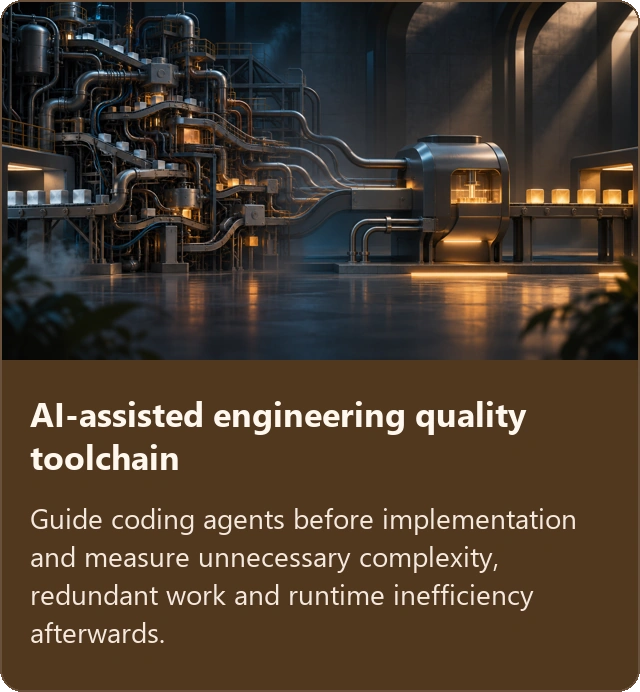

  <strong>Self-taught developer · Creative thinker · Melbourne, Australia</strong>  
  <a href="https://flow-form.com.au"> FlowForm demo</a>
  &nbsp; · &nbsp;
  <a href="https://github.com/Shayman-M-86?tab=repositories"> Repositories</a>
  &nbsp; · &nbsp;
  <a href="https://www.linkedin.com/in/shayman-mcgee-b224a2140/"> LinkedIn</a>

I like taking things apart, understanding the connections and building something useful. My background spans photography, business ownership, team management and logistics. Software brings those experiences together through creative problem-solving and a fascination with how systems work.

## Selected work

| ↳ FlowForm | ↳ SelectSpeak | ↳ CGT Tracker |
| :--- | :--- | :--- |
| **Surveys that adapt.** | **Text you can listen to.** | **Numbers you can trace.** |
| A full-stack survey platform exploring branching logic, versioned publishing and privacy-conscious data design. **Beta.** | A Windows reading tool combining local speech, text capture and OCR in an everyday shortcut. | A share and ETF tracking application built around reproducible calculations and transparent parcel history. |
| Python · React · PostgreSQL | Python · Native Windows integration | Python · Streamlit · SQLite |
| [Explore project →](https://github.com/Shayman-M-86/FlowForm) | [Explore project →](https://github.com/Shayman-M-86/SelectSpeak) | [Explore project →](https://github.com/Shayman-M-86/CGT_Calculator) |

<strong>How I approach the work</strong>

**Question → understand → build → test → refine.**

I care about clear boundaries, practical simplicity and taking responsibility for the result. AI-assisted engineering is part of my workflow; understanding the system, reviewing changes and verifying behaviour remain my responsibility.

Running **In Shot Media** taught me to connect creative decisions with real requirements, communicate clearly and carry projects through to delivery.

**Currently exploring:** backend architecture · home labs & infrastructure · AI developer tooling

<!-- FLOWFORM_IDEAS:START -->
### 💡 Current FlowForm ideas

  
  
  

<!-- FLOWFORM_IDEAS:END -->

---

<a href="https://github.com/Sur1ive/contribution-fx" title="Animated contribution graph powered by contribution-fx">
  <picture>
    <source media="(prefers-color-scheme: dark)" srcset="https://raw.githubusercontent.com/Shayman-M-86/Shayman-M-86/output/contribution-fx-dark.svg"/>
    
  </picture>
</a>

*The more I understand, the more I realise there is to explore.*
