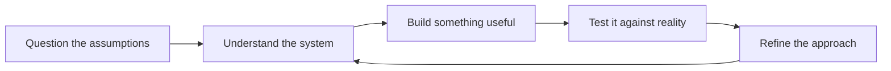

# Shayman McGee

### Curious by nature. Creative by instinct. Analytical by choice.

**Self-taught software developer · Melbourne, Australia**

I like understanding how things work, why they work that way, and what could make them better. Software is where that curiosity meets my creative side: a way to turn ideas into tools people can use.

My background spans photography, business ownership, team management and logistics. Today, I build software with a particular interest in backend engineering, system architecture and the details beneath the interface.

**[Explore FlowForm](https://flow-form.com.au)** · **[Browse my projects](https://github.com/Shayman-M-86?tab=repositories)** · **[Get in touch](mailto:shaymanmcgee1@hotmail.com)**

[What I build](#what-i-build) · [How I think](#how-i-think) · [Beyond the code](#beyond-the-code) · [What I’m exploring](#what-im-exploring)

---

## What I build

### FlowForm
**Adaptive surveys · Full-stack product · Beta**

A survey should follow the person answering it. FlowForm brings branching questionnaires, publishing, participant access and response review into one workspace.

This is my most substantial independent project, spanning the product interface, API, database design, access controls, encrypted response storage and infrastructure tooling.

**The question behind the engineering:** How do you let a survey evolve without changing the meaning of answers already collected?

<strong>Explore the design decisions</strong>

- **Preserve published meaning.** Responses belong to a fixed survey version while authors work on the next draft.
- **Make data boundaries deliberate.** Identity-bearing metadata and encrypted answers live in separate PostgreSQL stores, connected by the authorised backend.
- **Keep contracts connected.** Backend definitions generate OpenAPI and TypeScript contracts, reducing duplication across Python and the frontend.
- **Build reusable behaviour.** Shared builder components support both the public demo and the application.
- **Make development repeatable.** Container tooling, automated checks and infrastructure definitions support development and deployment.

**Built with:** Python, Flask, Pydantic, SQLAlchemy, PostgreSQL, React, TypeScript, Astro, Auth0, Docker and AWS.

FlowForm is in active development. The repository documents the implementation and its current boundaries.

**[Try the public builder](https://flow-form.com.au/#builder)** · **[Explore the source](https://github.com/Shayman-M-86/FlowForm)** · **[Read the documentation](https://github.com/Shayman-M-86/FlowForm/blob/main/docs/docs-index.md)**

### SelectSpeak
**Accessibility · Windows desktop application**

Select text, press a shortcut and hear it read aloud. SelectSpeak brings local speech, screen-text recognition and playback controls into an everyday Windows workflow.

**The question behind the engineering:** How can a useful reading tool fit around what someone is already doing?

<strong>Explore the engineering</strong>

The application combines Python with a native Windows bridge for selection capture, global shortcuts and speech integration. Local OCR makes text in screenshots readable, while word highlighting helps connect the spoken audio to the text.

Selected text and generated speech stay on the computer. Setup downloads the required runtime and any selected optional voice components.

The work extends beyond speech generation into responsive playback, cancellation, persistent settings, installation and upgrades.

**[Explore SelectSpeak](https://github.com/Shayman-M-86/SelectSpeak)**

### CGT Tracker
**Financial software · Traceable calculations**

A tool for tracking Australian share and ETF transactions, parcel allocations and cost-base adjustments, with an interactive dashboard and exportable reports.

**The question behind the engineering:** Can someone follow a calculated result all the way back to its source?

<strong>Explore the calculation model</strong>

The calculation engine rebuilds state from imported trade history. This replay-based approach keeps parcel allocations and summaries reproducible as records are corrected or recalculated.

Shared calculation logic supports both the Streamlit dashboard and command-line workflows. The application includes manual corrections, AMIT adjustments, CSV/PDF exports and backups before changes.

**Built with:** Python, Streamlit, SQLAlchemy, SQLite, Pandas and Plotly.

**[Explore CGT Tracker](https://github.com/Shayman-M-86/CGT_Calculator)**

<strong>Also exploring: reusable backend components</strong>

My [JWT Verification Flask Extension](https://github.com/Shayman-M-86/JWT_Verification_Flask_Extension) explores authentication and authorisation through signature and claims validation, JWKS key resolution, defensive caching, and role/permission checks.

It reflects an interest that runs through my larger projects: making responsibilities explicit and components easier to reason about.

---

## How I think

I learn by building a mental model, trying it against a real problem and revising it when the evidence disagrees.

<strong>Understand the why</strong>

I want to know what a tool does, where its limits are and why a particular approach fits the problem. Breaking a system into smaller parts helps me understand how those parts affect one another.

<strong>Make complexity earn its place</strong>

I enjoy complex problems, but I want the resulting software to be understandable. Clear boundaries, explicit data flows and practical workflows matter to me. A design should make the next change easier to reason about.

<strong>Take responsibility for the result</strong>

Running a business taught me that delivery includes communication, reliability and what happens after the handover. I bring that perspective to software: how people use it, how failures are handled and how it can be maintained.

<strong>Use AI with engineering judgement</strong>

AI-assisted development is part of my workflow, and an area I actively explore through developer tooling, context management and agent workflows.

I value clear requirements, reviewable changes and verification. Understanding the system and taking responsibility for the outcome remain my job.

## Beyond the code

Photography and software share an appeal for me: both combine technical constraints with room for experimentation and creative decisions.

Running **In Shot Media** has involved everything from understanding a client's brief to planning, capturing, editing and delivering the finished work. Retail management and logistics have added another perspective: coordinating people, adapting under pressure and keeping everyday operations moving.

Those experiences shape what I build. I care about the person using a tool as much as the system behind it.

Away from application development, my interests include computer hardware, home labs, networking, virtualisation and the wider world of engineering.

## What I'm exploring

- **Systems and infrastructure:** reproducible environments, cloud deployment and home-lab experimentation.
- **Developer tooling:** AI-assisted workflows, MCP tools and better ways to manage engineering context.
- **Product design:** making capable software approachable, accessible and useful.

My learning combines independent projects with Udacity study in programming, Python, SQL and backend development.

---

**Curiosity, integrity, accountability and independent thinking** guide how I work. I enjoy exchanging ideas with people who question assumptions, share what they know and take pride in what they create.

If you're building something useful, exploring a difficult problem or looking for a developer who likes understanding the whole system, [I'd be glad to talk](mailto:shaymanmcgee1@hotmail.com).

*The more I understand, the more I realise there is to explore.*
